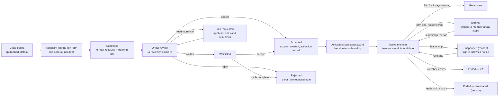

# Membership lifecycle — business process (Sprint 18)

The full life of a person in the community, from the day an intake cycle opens to the day their membership ends. This
is the reference for the Sprint 18 stories ([plan](./plan.md)); the database is the authority for every rule below
(SECURITY DEFINER functions with explicit checks, audit on every change, permissions from the database per ADR-004).

## 1. The journey at a glance

Any account (member or not) can also be **blocked** by leadership: the person cannot sign in and sees a notice that
the account is blocked and how to contact the administration. Blocking is about the account; suspension and ending are
about the membership.

## 2. States

### 2.1 Application (`membership_applications.status`)

| State | Meaning | Who moves it | Applicant sees |
| ----- | ------- | ------------ | -------------- |
| `submitted` | Sent during an open cycle | applicant | "Received" + reference number + tracking link |
| `under_review` | A reviewer claimed it (one reviewer at a time; system admin may override) | reviewer | "Under review" |
| `info_requested` **new** | The reviewer needs a correction or more detail; the applicant can edit and resubmit while the cycle's review window lasts | reviewer → applicant | the request, a link to edit |
| `waitlisted` | Good application, no place yet | reviewer | "Waitlisted" |
| `accepted` | Becomes a member; an account is created or reused | reviewer | e-mail with the activation link |
| `rejected` | Not accepted (optional note shown to the applicant, internal note never shown) | reviewer, or automatic for waitlisted when the cycle completes | e-mail |
| `withdrawn` | The applicant withdrew before a decision | applicant | confirmation |

Rules: one application per e-mail per cycle (exists); a reviewer never decides their own application (exists); capacity
is checked at acceptance (exists); decisions can be taken in bulk (exists, up to 200, per-row result); every decision is
audited and e-mailed once.

### 2.2 Account activation (accepted applicants)

| State | Meaning |
| ----- | ------- |
| invited | Account created on acceptance, activation link e-mailed (valid 7 days) |
| activated | Password set; first sign-in opens onboarding (complete the profile) |
| invite expired | Link no longer valid; a reminder goes at day 3 and day 6; leadership can resend from the member page |

### 2.3 Membership (`members.status`, expanded)

| State | Meaning | Access |
| ----- | ------- | ------ |
| `active` | A current member; `term_ends_at` set | full member access |
| `suspended` | Temporarily stopped by leadership, reason required (exists as a value, but nothing blocks access today) | sign-in shows a "membership suspended" notice; member pages, directory listing and member-only actions stop |
| `expired` **new** | The term ended without renewal (automatic, daily job) | sign-in shows "membership ended on …, contact leadership to renew"; hidden from the directory |
| `ended` **new** (replaces `inactive`) | The membership is over: `end_reason` = `left` (member chose), `terminated` (leadership, reason required), `not_renewed`, `legacy` | account stays for history (certificates, registrations) but has no member access; hidden from the directory |

Existing `inactive` rows migrate to `ended` with `end_reason = 'left'` (or `legacy` for legacy records).

### 2.4 Account (`profiles`, new fields)

| Field | Meaning |
| ----- | ------- |
| `blocked_at`, `blocked_by`, `blocked_reason` | Account blocked by leadership. The auth user is banned too, so existing sessions end; sign-in shows the blocked notice. Unblocking clears both. |

## 3. Term and renewal

- Each membership has `term_starts_at` and `term_ends_at`. Default (Q-L1): the term ends on the date set on the cycle
  (`membership_cycles.term_ends_at`, e.g. the end of the academic year); without it, one year after acceptance.
- Reminders e-mail the member 30, 7 and 1 day(s) before the end. The dashboard shows "ending soon" (≤ 30 days).
- At the end date a daily job (cron route protected by `CRON_SECRET`, the same pattern as the e-mail retry route)
  moves `active` → `expired`, writes the audit entry and e-mails the member. It is idempotent and safe to re-run.
- Renewal: leadership renews one or many members (bulk) to a new end date; `expired` → `active`. Q-L2 decides whether
  members can request renewal themselves (default: a "request renewal" button that notifies leadership).

## 4. Leaving, termination, suspension, blocking

| Action | Who | Needs | Effect | E-mail |
| ------ | --- | ----- | ------ | ------ |
| Leave the community | the member | confirmation dialog | `ended` / `left`, positions end, hidden from directory | confirmation |
| End membership (terminate) | `members.manage` | reason (internal) and optional message to the member | `ended` / `terminated`, positions end | yes, with the optional message |
| Suspend / reinstate | `members.manage` | reason; optional end date of the suspension | `suspended` ↔ `active`; positions are kept but inactive | yes |
| Renew | `members.manage` | new end date | `expired` or `active` → `active` with new `term_ends_at` | yes |
| Block / unblock account | `users.block` **new** (system admin, community leader) | reason | account banned, sessions end, sign-in notice | yes |

All of them work one by one from the member page and in bulk from the members list (selection bar, ≤ 200 rows,
per-row result list like the applications bulk decision). Self-actions and actions on someone with a higher role are
refused (a community leader cannot block the system administrator; nobody blocks themselves).

## 5. What a person sees when they sign in

| Situation | What happens |
| --------- | ------------ |
| blocked account | sign-in succeeds in auth but the app shows a modal: "Your account is blocked. Contact the administration: …"; then signs out |
| suspended membership | a modal with the reason category and contact; the account area works (security, my data), member pages do not |
| expired membership | a modal "Your membership ended on <date>"; the "request renewal" action (Q-L2) |
| ended membership | the account works for history (my data, certificates); member pages say the membership has ended |

Server-side checks enforce all of this (RLS and the member functions check `status = 'active'` already for writes;
new: reads of member-only pages and the directory, and a session check for blocked accounts). The modal is only the
explanation.

## 6. Permissions (from the database, ADR-004)

| Key | Holders (default) | Used for |
| --- | ----------------- | -------- |
| `membership.manage_cycles` (exists) | system admin, community leader | cycles, term end date per cycle |
| `membership.review` (exists) | system admin, community leader | decisions, info requests, bulk decisions |
| `members.manage` (exists) | system admin, community leader | renew, suspend, end, resend activation, bulk member actions |
| `users.block` **new** | system admin, community leader | block / unblock any account |
| `members.edit_own_name` (Sprint 17) | system admin, community leader, founders | unchanged |

## 7. E-mails (new templates marked)

`membership.application_received` (add the tracking link) · **`membership.info_requested`** ·
`membership.application_accepted` (activation) · **`membership.activation_reminder`** · `membership.application_rejected`
· `membership.application_waitlisted` · **`member.term_reminder`** (30/7/1) · **`member.expired`** ·
**`member.renewed`** · **`member.suspended`** · **`member.reinstated`** · **`member.ended`** (left / terminated) ·
**`account.blocked`** · **`account.unblocked`**. Both languages, the member's preferred language, sent once
(idempotency key per event), retried by the existing retry route.

## 8. Audit and history

Every transition writes `private.write_audit` with actor, reason and before/after status. The member page shows one
timeline: applied, decided, activated, positions, renewals, suspensions, end. Reviewers see the application's own
timeline (submitted, claimed, info requested, resubmitted, decided, e-mails sent).
